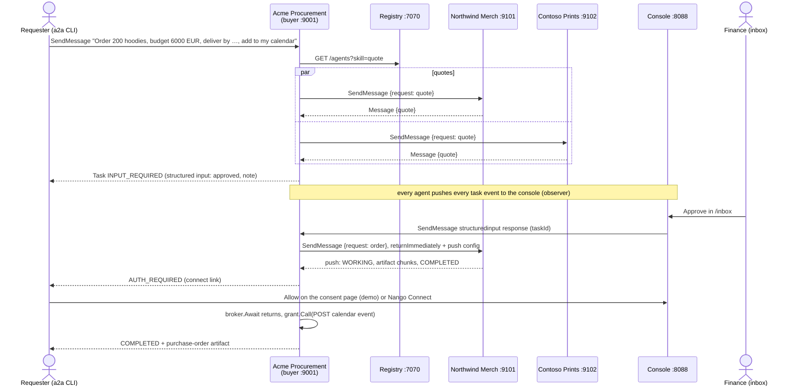

# Procurement handoff

Five processes' worth of A2A in one command. Acme's procurement agent buys 200 hoodies: it finds suppliers in a registry, compares their quotes, gets a person to approve the spend, places the order, follows fulfilment through push notifications, asks the requester to connect their calendar, and puts the delivery date in it. A console traces everything across agents.

The flow is deterministic and needs no LLM or API key.



## Run it

```sh
go run ./cmd/demo
```

It prints the URLs. In a second terminal, using the [`a2a` CLI](https://github.com/a2aproject/a2a-cli):

```sh
a2a card get -a localhost:9001
curl 'localhost:7070/agents?skill=quote'
a2a send -a localhost:9001 "Order 200 hoodies, budget 6000 EUR, deliver by 2026-11-19, add to my calendar"
```

Pick a delivery date about three weeks out; the demo prints one. The task stops in `input-required`:

```text
Approve 200 hoodies from Northwind Merch for 5416.00 EUR (ships 2026-11-05)? The total is above the
5000 EUR approval limit. Northwind Merch is the cheapest of 1 quote(s) that ship in time.
Excluded: Contoso Prints ships 2026-11-28, after 2026-11-19.
```

1. Open **http://localhost:8088/inbox** and press **Approve**. Any A2A client can answer instead, for example `a2a send -a localhost:9001 --task-id <id> --data-part '{"approved":true,"note":"ok"}'`. The question carries a JSON Schema, and the buyer accepts any data part that matches it.
2. The buyer places the order with Northwind and waits for its push notifications. When the order ships, the buyer goes `auth-required` with a link (`a2a task get -a localhost:9001 <id>`). Open the link, or use **Connect** in the inbox, and press **Allow**.
3. The task completes with a `purchase-order` artifact. The event is under **Demo calendar** in the console nav.
4. Open **http://localhost:8088** to see the task tree, buyer → supplier, with each task's timeline and its time split between working, waiting on a human and waiting on a credential.

Variations:

- `"Order 50 mugs"`: under the limit and with no deadline, so the cheaper, slower supplier wins and the order is auto-approved.
- Press **Reject** in the inbox: the task ends `rejected`, naming who rejected it.
- Order a second time with "add to my calendar": the calendar connection is reused, so there's no `auth-required` step.
- `-credentials=none` skips the calendar step.

## With real Nango and Google Calendar

1. Sign up at [app.nango.dev](https://app.nango.dev), or [self-host](https://nango.dev/docs/guides/platform/free-self-hosting) and pass `-nango-base-url`.
2. Add a **Google Calendar** integration with the `https://www.googleapis.com/auth/calendar.events` scope and the ID `google-calendar`, or pass `-integration <id>`. For a quick test, Nango's developer OAuth app is enough. For your own Google OAuth client, add Nango's callback URL to it.
3. Run:

   ```sh
   export NANGO_SECRET_KEY=...   # Environment settings → secret key
   go run ./cmd/demo -credentials=nango
   ```

4. The `auth-required` link is a Nango Connect link (valid for 30 minutes). After you connect, the buyer finds the connection within 2 s (it polls), creates the event through the Nango proxy, and completes. The event is in your real calendar.

Webhooks are optional. If Nango can reach the console (through a tunnel, say), set its webhook URL to `https://<public console>/webhooks/nango/` and pass `-nango-webhook-signing-key`. Unsigned webhooks are refused.

## What's where

| Path | Role |
|---|---|
| [`buyer/`](buyer/buyer.go) | The orchestrator executor: parse, registry search, parallel quotes, choose, approval via `structuredinput`, order + push webhook ([`tracker.go`](buyer/tracker.go)), `AUTH_REQUIRED` via `credentials.Broker`, purchase order |
| [`supplier/`](supplier/supplier.go) | `quote` answers with a plain Message (no task). `order` is a task that streams a fulfilment artifact in chunks and ends with a confirmation artifact |
| [`protocol/`](protocol/protocol.go) | The JSON both sides exchange as data parts |
| [`internal/agentkit/`](internal/agentkit/agentkit.go) | Serves an executor: JSON-RPC, card, push, and the console observer |
| [`stack/`](stack/stack.go) | Starts everything on its own ports; used by `cmd/demo` and the tests |
| [`e2e_test.go`](e2e_test.go) | The full flow: approval, AUTH_REQUIRED, consent, completion, console tree, reuse of the connection, rejection, auto-approval |

```sh
go test -race ./...
```

Everything is in memory. Restarting loses all tasks.

## License

Apache-2.0
